<p align="center">
  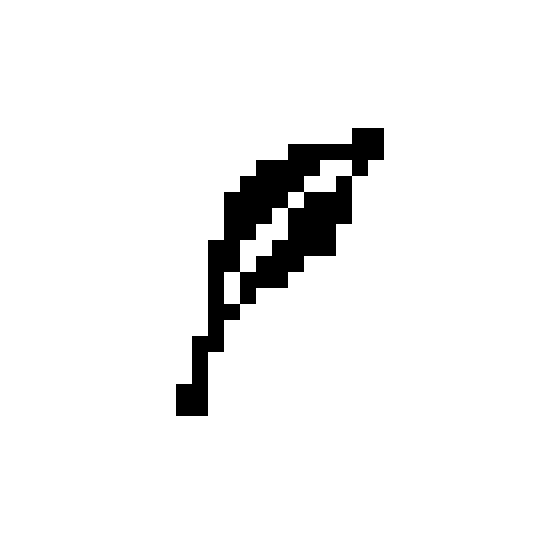
</p>

<h1 align="center">Pluma<br><sub><sup><sup><sub>Copyright (©) 2026 Erik Pimenta</sub></sup></sup></sub></h1>

<p align="center">
  Site para treinar digitação em português. No modo <b>Livre</b> não há cronômetro: os textos vão chegando e você treina no seu ritmo. No modo <b>Teste</b>, o tempo começa no primeiro toque e, no fim, vem um diagnóstico com tempo final, erros, acertos, precisão e toques líquidos. Escolha entre texto, palavras, sem acentos, alfabeto, números, teclado numérico, dados, misto ou o seu próprio texto, inclusive enviado em <code>PDF</code>, <code>DOCX</code>, <code>DOC</code>, <code>ODT</code> ou <code>TXT</code>, em três tamanhos e três complexidades.<br>
  Roda de três maneiras: online no GitHub Pages, com dois cliques no <code>Pluma.html</code> ou pelo servidor local em Java, sem instalar nada além do Java.<br>
  Ou abra direto no navegador, sem baixar nada: <a href="https://ravelroot.github.io/Typing-Practice-Platform/">ravelroot.github.io/Typing-Practice-Platform</a>.<br>
  Pronto para baixar e usar.
</p>

<p align="center">
  TypeScript · HTML5 · CSS3 · JavaScript (build) · Java 21 (servidor local e conferência do acervo) · esbuild · Node Test Runner · Playwright · GitHub Actions · GitHub Pages
</p>

---

> **Versão 1.0.0 (Atual):** primeira versão do Pluma, com os modos **Livre** e **Teste**, nove conteúdos (**Texto**, **Palavras**, **Sem acentos**, **Alfabeto**, **Números**, **Teclado num.**, **Dados**, **Misto** e **Customizado**) em três tamanhos e três complexidades, **envio de PDF, DOCX, DOC, ODT e TXT** adaptados para digitar e divididos em partes, **diagnóstico** completo com o ritmo segundo a segundo, **teclado na tela** ABNT2 e numérico com a cor do dedo certo, **histórico e recordes** salvos no navegador, as **paletas** Pluma, Bento, Sonda e Nexo com tema claro e escuro e um **tutorial rápido** de oito passos. Detalhes no [`CHANGELOG.md`](CHANGELOG.md).

<p align="center">
  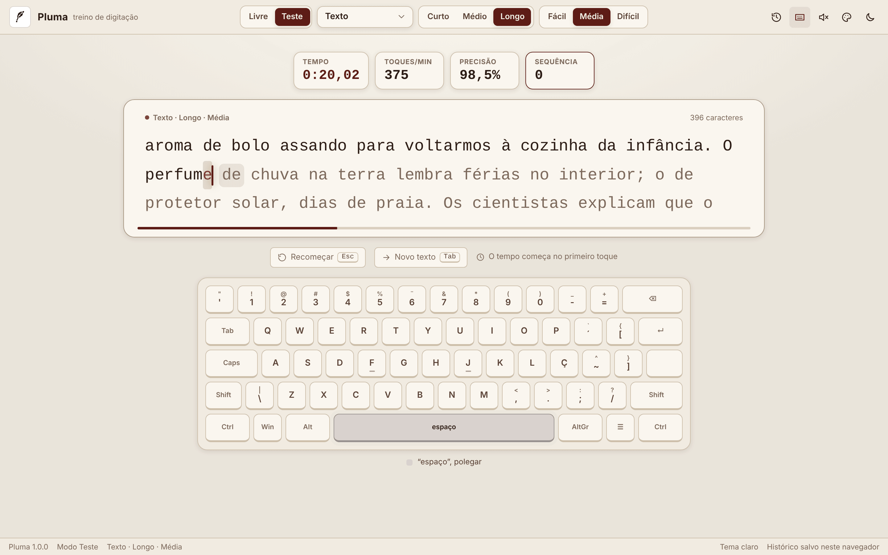
</p>

## O que o Pluma faz

- **Dois modos:** **Livre**, sem cronômetro, com os textos emendados um atrás do outro e o diagnóstico da sessão inteira quando você quiser (Ctrl+Enter); e **Teste**, que mede do primeiro ao último toque e mostra o tempo final.
- **Nove conteúdos** em português, sempre digitáveis num teclado ABNT2: frases e parágrafos, palavras soltas, os mesmos textos sem acentos, o alfabeto, números da fileira de cima, contas para o teclado numérico, registros como numa planilha, uma mistura de tudo e o seu próprio texto. Detalhes em [Conteúdos](#conteúdos).
- **Seu documento vira treino:** envie um **PDF, DOCX, DOC, ODT ou TXT** (ou arraste o arquivo para a página). O Pluma tira o texto, troca o que não existe no teclado (aspas curvas, travessões, marcadores, ligaduras) e divide documentos longos em partes, para digitar o documento inteiro aos poucos. Detalhes em [Texto customizado e documentos](#texto-customizado-e-documentos).
- **Diagnóstico completo:** tempo final, toques brutos, acertos, erros corrigidos e não corrigidos, precisão, toques líquidos e toques líquidos por minuto, palavras por minuto, consistência, maior sequência, o gráfico do ritmo e as teclas que mais erraram. Detalhes em [Diagnóstico](#diagnóstico).
- **Digitação fluida e satisfatória:** o cursor desliza por mola de uma letra para a outra, as linhas rolam suavemente, a palavra atual ganha um realce que acompanha o cursor, cada acerto “ganha tinta”, os erros tremem em vermelho, as sequências de acertos são comemoradas com faíscas em pixel art e o fim do teste solta penas na tela.
- **Teclado na tela:** acende a próxima tecla na cor do dedo certo, mostra o Shift do lado oposto e a sequência dos acentos (´ ~ ^ `) do padrão ABNT2; no teclado numérico, mostra o bloco numérico.
- **Histórico e recordes:** cada resultado fica salvo neste navegador, com a evolução dos testes, o recorde de cada categoria e exportação em CSV.
- **Paletas e tema:** Pluma, Bento, Sonda e Nexo, cada uma com versão clara e escura. Detalhes em [Paletas de cores](#paletas-de-cores).
- **Tutorial rápido:** oito passos que escurecem a tela e acendem a parte explicada; dá para pular e ele fica no menu do logo.
- **Leve e privado:** o site inteiro é um arquivo de cerca de 200 KB, sem bibliotecas no navegador, sem rastreadores e sem enviar nada para servidores. Funciona sem internet.

<p align="center">
  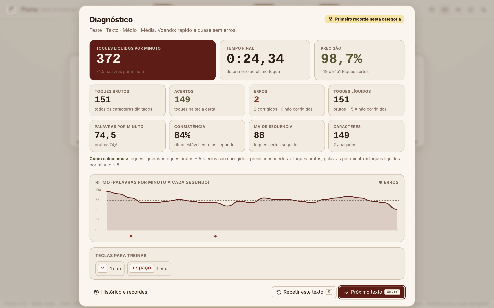
  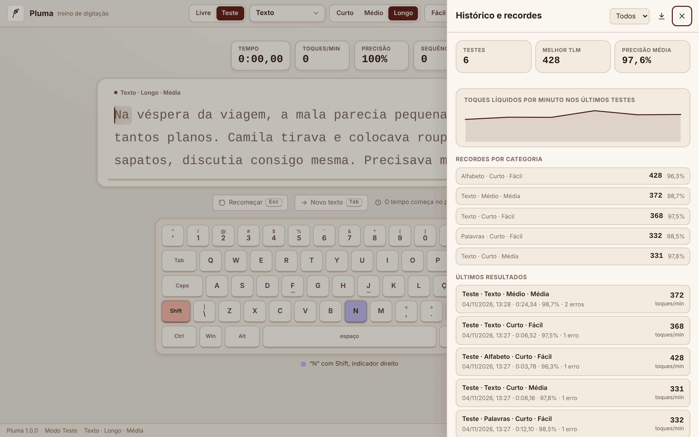
</p>

<p align="center">
  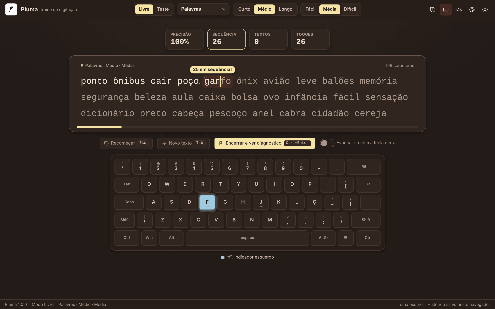
  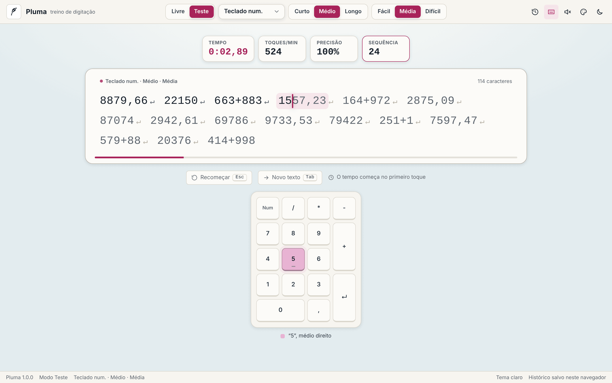
</p>

## Modos

| Modo | Cronômetro | Quando termina | O que fica salvo |
|---|---|---|---|
| **Livre** | Não há. Pausas longas nem contam no tempo ativo | Quando você aperta **Encerrar e ver diagnóstico** (Ctrl+Enter); os textos vão emendando um atrás do outro | A sessão inteira, com quantos textos foram concluídos |
| **Teste** | Começa no primeiro toque e para no último | No último caractere do texto | O teste, com o tempo final; o melhor resultado de cada categoria vira recorde |

No modo Livre dá para ligar **Avançar só com a tecla certa**: a letra errada não entra no texto, o cursor treme e você tenta de novo. É o jeito mais calmo de treinar precisão.

## Conteúdos

O seletor ao lado dos modos troca o que aparece para digitar. Os tamanhos e as complexidades valem para todos, menos o Customizado, em que o tamanho define o tamanho das partes.

| Conteúdo | O que aparece | Fácil → Difícil |
|---|---|---|
| **Texto** | Frases e parágrafos originais em português | Ordem direta e poucas vírgulas → acentos, aspas, números, siglas, crase, porcentagens e valores |
| **Palavras** | Palavras soltas | Comuns e curtas → longas, com acento, hífen e nomes de cidades e estados |
| **Sem acentos** | Os mesmos textos, sem acento e sem cedilha | Igual ao Texto |
| **Alfabeto** | De a a z | Em ordem → com espaços → embaralhado |
| **Números** | Números na fileira de cima | Até três dígitos → decimais e milhares → R$, %, datas, horas, frações e sinais |
| **Teclado num.** | Contas para o bloco numérico, uma por linha, com Enter | Números inteiros → decimais com vírgula → contas com + − * / |
| **Dados** | Registros como numa planilha, um por linha | Pedido, quantidade e cidade → data, item, valor e UF → nota fiscal, horário, SKU, conta, CEP e e-mail |
| **Misto** | Palavras, números, letras soltas, onomatopeias (tic-tac, vrum, atchim…) e símbolos, tudo junto | Sem pontuação → com maiúsculas e pontuação → com @, #, colchetes, aspas, e-mails e valores |
| **Customizado** | O seu texto, colado, escrito ou enviado em documento | Tamanho das partes: Curto (~160), Médio (~420) e Longo (~900 caracteres) |

Curto, Médio e Longo mudam o tamanho: de uma frase (~25 a 95 caracteres) a um parágrafo inteiro (~300 a 560 caracteres) no Texto, de 12 a 60 palavras no Palavras e de 8 a 30 linhas no Teclado num. Cada novo texto é sorteado (Tab), sem repetir o anterior.

## Texto customizado e documentos

<p align="center">
  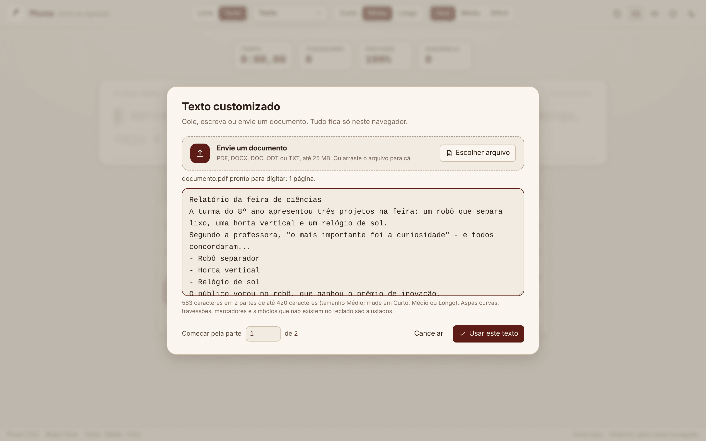
  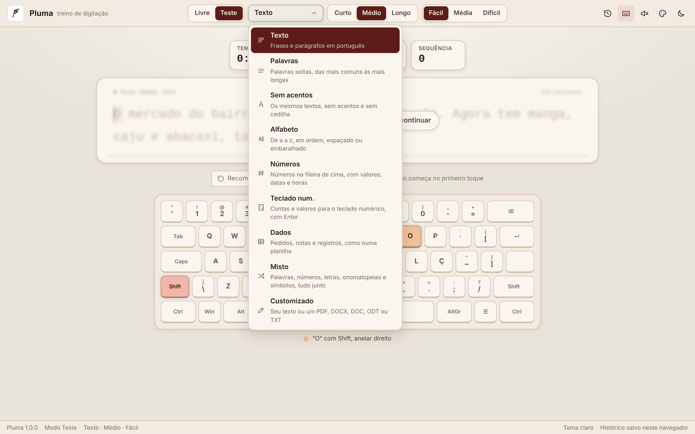
</p>

Em **Customizado**, cole ou escreva o texto, clique em **Escolher arquivo** ou arraste um documento para qualquer lugar da página. Tudo é lido no próprio navegador, sem enviar o arquivo para lugar nenhum.

| Formato | Como o texto é lido |
|---|---|
| **PDF** | Lê os objetos e os *object streams*, descompacta (Flate, ASCII85, ASCIIHex e LZW), decodifica as fontes pelo ToUnicode, pelas codificações WinAnsi e MacRoman e pelos nomes dos glifos, e reconstrói linhas e parágrafos pela posição de cada letra (títulos, listas, hifenização no fim da linha e várias páginas). PDFs digitalizados, sem texto selecionável, ou protegidos por senha avisam o motivo |
| **DOCX** | Lê o `word/document.xml` de dentro do ZIP: parágrafos, quebras, tabulações, hífens inseparáveis e itens de lista; campos e texto apagado ficam de fora |
| **DOC** | Lê o formato binário do Word 97 a 2003: o arquivo composto, a tabela de partes do texto (8 e 16 bits) e só o corpo do documento, sem códigos de campo |
| **ODT** | Lê o `content.xml` do LibreOffice e do Google Docs: parágrafos, títulos, espaços repetidos, tabulações e quebras, sem os comentários |
| **TXT** | UTF-8, UTF-16 (com BOM) e Windows-1252, detectados sozinhos |

Depois de lido, o texto é **adaptado para digitar**: aspas curvas viram retas, travessões e meias-riscas viram hífen, reticências viram três pontos, marcadores no começo da linha viram “- ”, ligaduras (fi, fl) são separadas, hífens suaves e espaços invisíveis somem e símbolos sem tecla viram texto (× → x, ½ → 1/2, © → (c), → → ->). O que não dá para digitar num teclado ABNT2 (emojis, outras escritas) é retirado, e a janela diz quantos caracteres saíram. Os parágrafos viram Enter no texto.

Documentos longos (até 100 mil caracteres) viram **partes** que respeitam frases e parágrafos. O topo mostra **parte 3 de 21**, **Próxima parte** (Tab) e **Parte anterior** andam entre elas, a janela deixa escolher por qual parte começar e o modo Livre segue sozinho para a próxima parte, até o fim do documento.

## Diagnóstico

No fim de cada teste (ou ao encerrar o modo Livre) aparece o **Diagnóstico**:

| Medida | O que é |
|---|---|
| **Tempo final** | Do primeiro ao último toque (no Livre, o tempo ativo, sem as pausas longas) |
| **Toques brutos** | Todos os caracteres digitados, certos ou errados (o Backspace não conta) |
| **Acertos** | Toques na tecla certa |
| **Erros** | Toques na tecla errada, separados em corrigidos (apagados depois) e não corrigidos |
| **Precisão** | Acertos ÷ toques brutos |
| **Toques líquidos** | Toques brutos − 5 × erros não corrigidos |
| **Toques líquidos por minuto** | Toques líquidos ÷ minutos, o número principal do teste |
| **Palavras por minuto** | Toques líquidos por minuto ÷ 5 (e as brutas, sem o desconto) |
| **Consistência** | Quão estável foi o ritmo entre os segundos (a partir de 3 segundos) |
| **Maior sequência** | Mais toques certos seguidos |

Abaixo vêm o **gráfico do ritmo**, em palavras por minuto a cada segundo, com os erros marcados, e as **teclas para treinar**, as que mais erraram, com a dica do dedo. O primeiro teste de cada categoria e os que batem o recorde ganham um selo. **Enter** vai para o próximo texto e **R** repete o mesmo.

## Teclado na tela

O teclado segue o padrão **ABNT2**, com Ç, a tecla de acentos ´ e `, a de ~ e ^, a tecla \ ao lado do Shift esquerdo e a / ao lado do Shift direito. A próxima tecla acende na cor do dedo que deve apertá-la, o Shift certo (do lado oposto à mão da letra) acende junto e as letras acentuadas mostram a sequência: primeiro o acento, depois a letra. Abaixo do teclado aparece a dica em texto, como “é: acento agudo (´) e depois e, médio esquerdo”. As teclas afundam quando você aperta e tremem em vermelho no erro. No **Teclado num.**, aparece o bloco numérico, com Enter, vírgula e as operações.

| Dedo | Cor |
|---|---|
| Mínimo esquerdo e direito | salmão e menta |
| Anelar esquerdo e direito | palha e pêssego |
| Médio esquerdo e direito | sálvia e rosa |
| Indicador esquerdo e direito | céu e lavanda |
| Polegares | pedra |

O botão de teclado no topo (Alt+K) mostra ou esconde o teclado.

## Histórico e recordes

O botão de histórico (Alt+H) abre o painel com o número de testes, o melhor resultado, a precisão média dos últimos dez, a evolução dos toques líquidos por minuto, o recorde de cada categoria (conteúdo, tamanho e complexidade) e os últimos 100 resultados, filtráveis por modo. **Exportar** baixa tudo em CSV, separado por ponto e vírgula, pronto para o Excel ou o Google Planilhas. O histórico guarda até 500 resultados e fica só neste navegador; **Preferências → Apagar histórico** limpa tudo.

## Paletas de cores

<p align="center">
  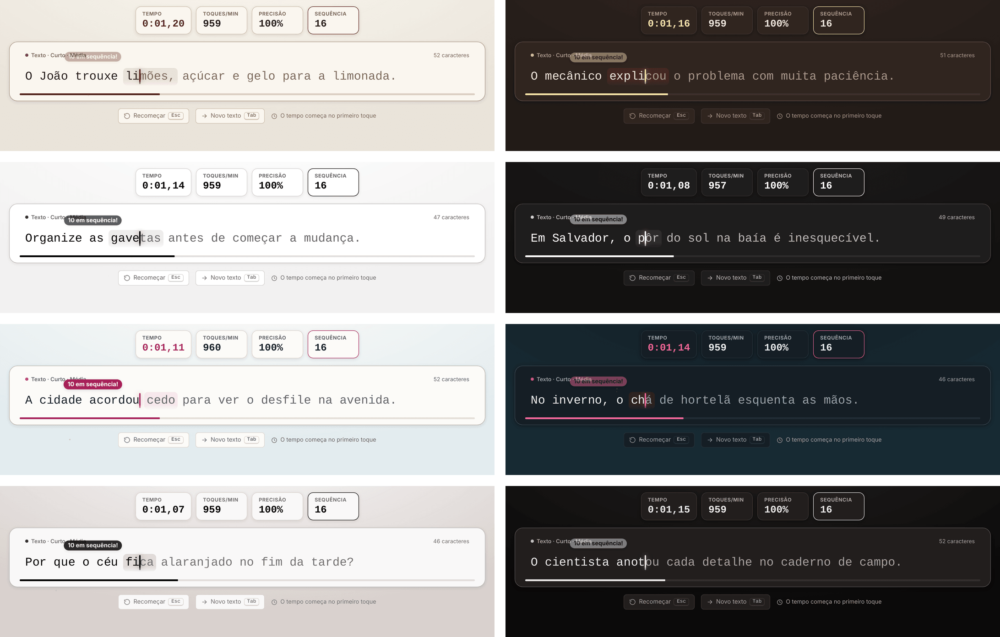
</p>

O botão com o ícone de paleta, no canto superior direito ao lado do botão de tema, abre a lista das paletas, mostradas só pelas cores. A paleta escolhida vale para a interface inteira (barra superior, placar, área de digitação, cursor, realce da palavra, teclado, diagnóstico e painéis) e funciona junto com o tema claro ou escuro.

| Paleta | De onde vem | Tema claro | Tema escuro |
| --- | --- | --- | --- |
| **Pluma** (padrão) | paleta original do Pluma | linho `#E6DDCE`, vinho `#5D1C16`, ardósia `#A3B4BE`, palha `#F6E4A6` | fundo `#1D1613`, destaque palha `#F6E4A6` |
| **Bento** | painel administrativo Bento | mesa `#F5F4F4`, caixa `#FFFFFF`, tinta `#000000`, alta `#3E6B2A`, queda `#9B2F1E` | mesa `#020202`, caixa `#121111`, destaque `#FFFFFF` |
| **Sonda** | motor de busca Sonda | papel `#F3F1EC`, folha `#FCFBF8`, tinta `#17212B`, água `#E3ECEF`, sinal `#A8235A` | papel `#0F161B`, água `#172A33`, sinal `#F0679A` |
| **Nexo** | paleta original do Nexo | papel `#E8E8E8`, pó `#D9D1CE`, pedra `#BAB7B5`, malva `#AB9D9D`, tinta `#000000` | fundo `#000000`, superfície `#121111`, malva `#AB9D9D` |

A escolha fica salva neste navegador e é aplicada antes de a tela aparecer, sem piscar. O tema começa igual ao do sistema e o botão de tema (Alt+T) alterna entre claro e escuro. As paletas são variáveis CSS em `:root[data-palette]` no [`web/css/pluma.css`](web/css/pluma.css), e a lista do menu fica em `PALETTES` no [`web/src/prefs.ts`](web/src/prefs.ts).

## Tutorial rápido

<p align="center">
  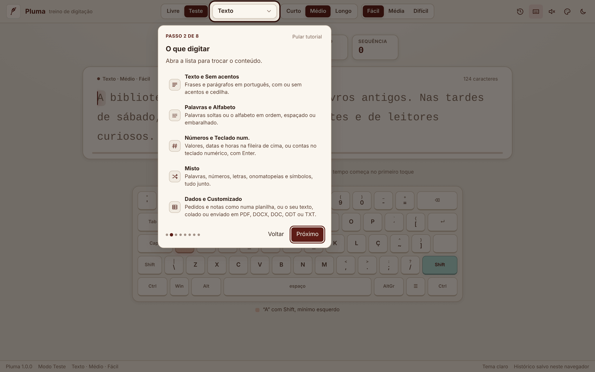
  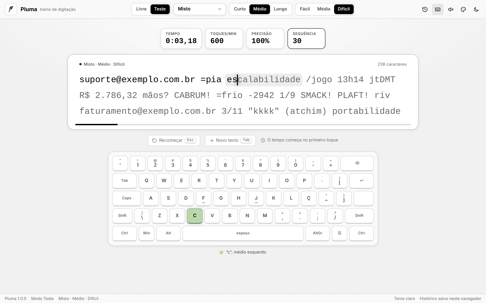
</p>

Na primeira vez que o Pluma abre, uma janela pergunta se você quer um tutorial rápido: **Ver tutorial** ou **Agora não**. Ele aparece uma vez só e fica sempre no menu do logo, em **Tutorial rápido**. São oito passos curtos que escurecem a tela e acendem a parte explicada:

| Passo | O que mostra |
|---|---|
| 1. Modos | Livre e Teste |
| 2. O que digitar | Os nove conteúdos |
| 3. Tamanho e complexidade | Curto, Médio e Longo; Fácil, Média e Difícil |
| 4. Digitar | Acertos e erros, Esc, Tab e Backspace |
| 5. Teclado na tela | A próxima tecla, o dedo certo e os acentos |
| 6. Diagnóstico | Tempo, erros, acertos, precisão e toques líquidos |
| 7. Histórico e recordes | O painel e a exportação em CSV |
| 8. Visual e preferências | Paletas, tema, som e preferências |

Cada item aparece com o ícone, o nome, o atalho e uma frase sobre o que faz; passar o mouse sobre ele acende o botão na tela. **Próximo** e **Voltar** (ou as setas → e ←) andam entre os passos, e **Pular tutorial** ou **Esc** fecham.

## Atalhos

| Atalho | O que faz |
|---|---|
| Tab | Novo texto (no Customizado, a próxima parte) |
| Esc | Recomeçar o texto atual |
| Ctrl+Enter | Encerrar a sessão do modo Livre e ver o diagnóstico |
| Backspace / Ctrl+Backspace | Apagar o último caractere / a última palavra |
| Enter / R | No diagnóstico: próximo texto / repetir o mesmo |
| Alt+H | Histórico e recordes |
| Alt+K | Mostrar ou esconder o teclado na tela |
| Alt+S | Ligar ou desligar o som das teclas |
| Alt+T | Alternar tema claro e escuro |
| Alt+P | Preferências (cursor em linha, bloco ou sublinhado, tamanho da letra, efeitos, som e histórico) |
| F1 | Lista de atalhos |

Colar texto, desfazer e as setas não funcionam na área de digitação, para que o resultado seja só da digitação.

## Arquitetura

```text
Pluma.html (gerado) ──► página + CSS + JavaScript num arquivo só, com CSP por hash
                         └── GitHub Pages publica o mesmo arquivo

Navegador
  Controles (modo, conteúdo, tamanho, complexidade) ──► Geradores com semente ──► Texto
                                                         └── acervo (textos.json, palavras.json)
  textarea invisível ──► diferença do que foi digitado ──► Sessão (toques com horário)
                                                              │
                     Visão do texto (cursor, rolagem e realce por mola, a 60 fps)
                     Efeitos (canvas em pixel art) · Som (Web Audio) · Teclado ABNT2
                                                              │
                                    Métricas (inteiras e exatas) ──► Diagnóstico
                                                              └──► Histórico (localStorage)
  Documentos ──► PDF · DOCX · DOC · ODT · TXT ──► adaptação para digitar ──► partes

Java 21 (opcional, sem dependências)
  tools/Servidor.java ──► serve o Pluma.html no computador ou na rede local
  tools/Acervo.java   ──► confere o acervo de textos e palavras no CI
```

- **Conteúdo (`web/src/content.ts`):** cada texto vem de um gerador com semente (mulberry32), que sorteia frases do acervo, palavras, números, contas, registros e misturas; a mesma semente gera sempre o mesmo texto. Também adapta textos customizados e divide documentos em partes.
- **Sessão (`web/src/session.ts`):** a digitação entra numa `textarea` invisível; a diferença entre o que estava lá e o que chegou vira toques e retrocessos. Assim os acentos com tecla morta do ABNT2 (´, ~, ^), a composição do macOS e os teclados de celular funcionam do mesmo jeito. Cada toque fica registrado com o horário, em milissegundos.
- **Métricas (`web/src/metrics.ts`):** o resumo é recalculado a partir dos toques registrados, com contas inteiras e arredondamento exato, e é o mesmo nos testes e na tela.
- **Visão (`web/src/view.ts`):** o texto é medido uma vez; a cada toque só mudam classes e transformações, sem novo layout. O cursor, o realce da palavra e a rolagem seguem molas (aproximação exponencial por quadro) num único `requestAnimationFrame`, que para quando tudo chega ao lugar.
- **Documentos (`web/src/documents.ts`, `web/src/pdf.ts`):** leitores próprios de ZIP, PDF, DOC (arquivo composto do Word) e XML, usando `DecompressionStream` do navegador.

## Como rodar

| Maneira | Para quem | Onde salva |
|---|---|---|
| 1. Online (GitHub Pages) | Quem quer só abrir e treinar, no computador ou no celular | Neste navegador |
| 2. Dois cliques no `Pluma.html` | Uso sem internet, em qualquer sistema, sem instalar nada | Neste navegador |
| 3. Servidor local em Java | Abrir pelo `localhost` ou em outros aparelhos da mesma rede | No navegador de cada aparelho |

### 1. Online

Abra [ravelroot.github.io/Typing-Practice-Platform](https://ravelroot.github.io/Typing-Practice-Platform/). É o mesmo `Pluma.html`, publicado no GitHub Pages a cada mudança.

### 2. Arquivo único (Pluma.html)

Baixe o [`Pluma.html`](Pluma.html) e abra com dois cliques. O site inteiro abre sem servidor e sem internet, com uma Content-Security-Policy que só deixa rodar os próprios scripts (conferidos por hash SHA-256) e bloqueia qualquer conexão de rede. O [`index.html`](index.html) da raiz abre o `Pluma.html` na hora. Funciona no Chrome, no Edge, no Firefox e no Safari, inclusive em pastas com espaço no nome, como `C:\Users\Seu Nome\Desktop`.

### 3. Servidor local em Java

Com o Java 21 ou mais novo, na pasta do projeto:

```bash
java tools/Servidor.java                 # http://localhost:8080
java tools/Servidor.java --porta 3000    # outra porta (0 escolhe uma livre)
java tools/Servidor.java --rede          # também para celulares e outros computadores da rede
```

Não precisa compilar nem baixar nada: o Java roda o arquivo direto. O servidor usa *virtual threads*, entrega a página compactada com gzip, responde 304 quando ela não mudou, manda cabeçalhos de segurança (CSP, `X-Frame-Options`, `nosniff`, `Referrer-Policy`, `Permissions-Policy`) e tem `/saude` para checagens. Ctrl+C encerra.

## Acervo de textos

| Tamanho | Fácil | Média | Difícil |
|---|---|---|---|
| Curto (uma frase) | 30 | 30 | 30 |
| Médio (duas ou três frases) | 24 | 24 | 24 |
| Longo (um parágrafo) | 14 | 14 | 14 |

São **204 textos originais**, escritos para o Pluma, sobre o dia a dia, ciência, cidades e culturas do Brasil, além de **592 palavras** em três níveis e **73 onomatopeias**. Tudo fica em [`web/data/textos.json`](web/data/textos.json) e [`web/data/palavras.json`](web/data/palavras.json). O [`tools/Acervo.java`](tools/Acervo.java) confere, no CI, se cada texto tem o tamanho certo, se usa só caracteres que existem no ABNT2, se os fáceis não têm números nem pontuação avançada e se não há textos, ids ou palavras repetidos:

```bash
java tools/Acervo.java web/data/textos.json web/data/palavras.json
```

## Desenvolvimento e testes

| Comando | O que faz |
|---|---|
| `npm ci` | Instala as ferramentas de desenvolvimento (esbuild, TypeScript e Playwright) |
| `npm run build` | Gera o `Pluma.html` a partir de `web/` |
| `npm run check` | Confere se o `Pluma.html` está em dia com o código |
| `npm run typecheck` | Checagem de tipos do TypeScript em modo estrito |
| `npm test` | Testes de unidade (Node Test Runner, rodando o TypeScript direto) |
| `npm run test:e2e` | Testes ponta a ponta no Chromium (Playwright), inclusive com o servidor em Java |
| `npm run acervo` | Conferência do acervo em Java |
| `npm run serve` | Sobe o servidor local em Java |

| Suíte | O que cobre | Resultado |
|---|---|---|
| Conteúdo (13 testes) | Gerador com semente, os nove conteúdos em todos os tamanhos e complexidades, tamanhos crescentes, frases do acervo certas, sem acentos, alfabeto, números, teclado numérico, dados com contas que fecham, misto, formatação brasileira, texto customizado | A mesma semente gera o mesmo texto; nenhum texto com espaço duplo ou sobrando |
| Métricas e sessão (14 testes) | Arredondamento exato, erros corrigidos e não corrigidos, toques líquidos, acentos e Enter como um toque, consistência, tempo ativo, sessões combinadas, ritmo por segundo, formatos em português, diferença da `textarea`, avançar só com a tecla certa | Resumo da sessão igual ao recalculado pelos toques |
| Documentos (12 testes) | DOCX, DOC, ODT e PDF do LibreOffice, PDF com *object streams* (qpdf), PDF do Chromium (Skia), PDF com fontes padrão sem ToUnicode, TXT em Windows-1252 e UTF-16, erros claros, XML do Word e do ODT, adaptação para digitar e divisão em partes | Os cinco documentos de teste viram exatamente o mesmo texto, parágrafo por parágrafo |
| Ponta a ponta (16 cenários) | `Pluma.html` direto do disco com CSP e sem erros, tutorial (aparece uma vez, anda pelas setas e reabre pelo menu), teste sem erros, erros corrigidos e não corrigidos, modo Livre e Ctrl+Enter, avançar só com a tecla certa, os nove conteúdos, texto customizado, envio de PDF com partes, teclado com acentos, colar bloqueado, paletas e tema salvos, histórico e CSV, celular sem rolagem lateral, sem efeitos, servidor em Java e acervo | Nenhum erro de JavaScript em nenhum cenário |
| Java | `javac -Xlint:all -Werror` e a conferência do acervo | 0 avisos; acervo em ordem |

O CI (GitHub Actions) roda tudo a cada push, confere se o `Pluma.html` está em dia com o código e compila as ferramentas em Java com avisos tratados como erro. Outro workflow publica o `Pluma.html` no GitHub Pages.

## Qualidade e segurança

- **Navegador:** CSP sem `unsafe-eval` e sem scripts de fora, com os dois scripts da página liberados por hash; `connect-src 'none'` (a página não faz nenhuma requisição de rede), sem `localStorage` de terceiros, sem fontes ou imagens externas. Textos enviados e nomes de arquivo entram sempre como texto, nunca como HTML.
- **Documentos:** lidos só no navegador, com limite de 25 MB por arquivo e 100 mil caracteres por texto; o leitor de PDF tem limites de profundidade, de objetos e de letras, recusa PDFs criptografados e não executa nada do arquivo; formatos desconhecidos são recusados pelo conteúdo, não só pela extensão.
- **Privacidade:** preferências, texto customizado e histórico ficam só no `localStorage` deste navegador. Não há contas, rastreadores nem envio de dados; o acervo e os exemplos não têm dados pessoais.
- **Servidor em Java:** só entrega o `Pluma.html` (qualquer outro caminho é 404 e outros métodos são 405), escuta só no `localhost` a menos que você peça `--rede`, manda cabeçalhos de segurança e não grava nada.
- **Acessibilidade:** controles por teclado, foco visível, rótulos para leitores de tela, aviso do resultado numa região `aria-live` e respeito a “reduzir movimento” do sistema (os efeitos também podem ser desligados nas preferências).
- **Desempenho:** o texto é medido uma vez por render; a cada toque só mudam classes e transformações, as animações usam `transform` e `opacity` e o laço de animação para quando nada se mexe.

### Estrutura

```text
Pluma.html                  o site inteiro num arquivo só (gerado)
index.html                  abre o Pluma.html com dois cliques
web/
  index.html                página (modelo do Pluma.html)
  css/pluma.css             estilos, paletas e animações
  img/favicon.svg           ícone
  data/                     acervo de textos, palavras e onomatopeias (JSON)
  src/                      TypeScript: conteúdo, sessão, métricas, visão, teclado, efeitos, som,
                            diagnóstico, histórico, preferências, tutorial, documentos e PDF
tools/
  Servidor.java             servidor local em Java 21
  Acervo.java               conferência do acervo em Java 21
scripts/build.mjs           build do Pluma.html (esbuild, CSP por hash)
tests/unit/                 testes de unidade (TypeScript)
tests/e2e/                  testes ponta a ponta (Playwright)
tests/fixtures/             documentos de exemplo para os leitores (PDF, DOCX, DOC, ODT e TXT)
docs/images/                logo e imagens do README
.github/workflows/          CI e publicação no GitHub Pages
```

### Componentes de terceiros

O Pluma não usa bibliotecas no navegador. Para construir e testar, usa ferramentas com licenças próprias, que continuam valendo para cada uma delas:

| Componente | Uso no projeto | Licença |
|---|---|---|
| [esbuild](https://esbuild.github.io/) | Empacotamento do TypeScript e do CSS no `Pluma.html` (só no build) | MIT |
| [TypeScript](https://www.typescriptlang.org/) | Checagem de tipos (só no desenvolvimento) | Apache-2.0 |
| [@types/node](https://github.com/DefinitelyTyped/DefinitelyTyped) | Tipos do Node.js para os testes (só no desenvolvimento) | MIT |
| [Playwright](https://playwright.dev/) | Testes ponta a ponta (só no desenvolvimento) | Apache-2.0 |

O Java usa só a biblioteca padrão do JDK. A interface usa as fontes do sistema e ícones desenhados no próprio código.

## Licença

Copyright (©) 2026 Erik Pimenta. Todos os direitos reservados.

O Pluma é distribuído sob uma [licença de uso](LICENSE) própria:

| Pode | Não pode |
|---|---|
| Usar de graça, online, com dois cliques no `Pluma.html` ou pelo servidor local em Java | Modificar o Pluma ou criar versões derivadas |
| Configurar pelas preferências, paletas e texto customizado | Copiar o código ou o acervo de textos, no todo ou em parte, para outros projetos |
| Usar como quiser os textos que você envia e o histórico que exporta | Redistribuir, publicar ou vender o Pluma |

Para pedir uma autorização que a licença não dá, fale com o autor pelo [GitHub](https://github.com/ravelroot). O texto completo está em [`LICENSE`](LICENSE).
